<div align="center">



Software developer in Baden, Switzerland. Currently at [etrex GmbH](https://www.etrex.ch/).

**Creative by nature. I love trying new things and turning ideas into working software, no matter how silly they sound.**

[](https://hello-eme.ch)
[](https://github.com/oldjazjef)
[](https://medium.com/@jazcan)
[](https://ch.linkedin.com/in/emanuel-m-109968159)
[](https://buymeacoffee.com/hello.eme)

</div>

---

## What I'm building

<table>
<tr>
<td width="50%" valign="top">

### [Moat](https://github.com/oldjazjef/moat)
*In development*

A tiny PHP gate for the hosting you already have. It keeps API keys out of the browser and forwards only the requests you explicitly allow: exact method and path, fixed HTTPS target, rate limits and size limits, lockable with one command. Config is signed data and secrets are sealed per gate, so even a compromised Moat Cloud can't compromise the gate. Includes a CLI and a desktop app.

`TypeScript` `PHP` `Electron` `Angular` `libsodium` `Nx`

</td>
<td width="50%" valign="top">

### [lazy-koins](https://github.com/oldjazjef/lazy-koins)
*[Live demo](https://lazy-koins.hello-eme.ch)*

Turns exports from crypto exchanges and wallets into the Swiss tax documents for one year: wealth on 31 December and income, as PDF and Excel. Declarative mappings (or let an AI write them), historical prices, ledger checks and a per-transaction tax breakdown. Web app, or a desktop app where your data never leaves your machine. Hobby project, not tax advice.

`Angular` `NestJS` `SQLite/Prisma` `Electron` `Nx`

</td>
</tr>
<tr>
<td width="50%" valign="top">

### [Mirrorbase](https://github.com/oldjazjef/mirrorbase)

A desktop app that copies a database from a saved source to a saved target. Encrypted connections with the key in the OS keychain, Docker discovery, run logs and a PIN lock. Every database type is a plugin: PostgreSQL and SQLite today.

`Electron` `Angular` `NestJS` `SQLite/Prisma` `Nx`

</td>
<td width="50%" valign="top">

### [bexio-dotnet](https://github.com/oldjazjef/bexio-dotnet)

A .NET client for the [bexio](https://www.bexio.com) API (2.0 and 3.0): invoices, orders, contacts, projects, time tracking, accounting and files. Personal token or OAuth2, automatic token refresh, multi-account, async, retried rate limits and DI via `AddBexio(...)`.

```
dotnet add package Bexio.DotNet
```

[](https://www.nuget.org/packages/Bexio.DotNet)

</td>
</tr>
</table>

### Smaller tools

| Project | What it does |
| --- | --- |
| [docker-ionic-build-android](https://github.com/oldjazjef/docker-ionic-build-android) | Build Android APKs with Ionic and Capacitor inside Docker |
| [redaxo-addon-env-middleware](https://github.com/oldjazjef/redaxo-addon-env-middleware) | [REDAXO](https://redaxo.org/) add-on: environments, env variables for the frontend and API proxying with server-side OAuth, so credentials never reach the browser |
| [vscode-json-tools](https://github.com/oldjazjef/vscode-json-tools) | VS Code extension: jump to nested JSON paths, browse a JSON outline, find where config keys are used |

---

## Stack

<div align="center">


</div>

---

<div align="center">

I write about this and that on [Medium](https://medium.com/@jazcan).
If something here saved you time, you can [buy me a coffee](https://buymeacoffee.com/hello.eme).

<a href="https://buymeacoffee.com/hello.eme" target="_blank"></a>

</div>
